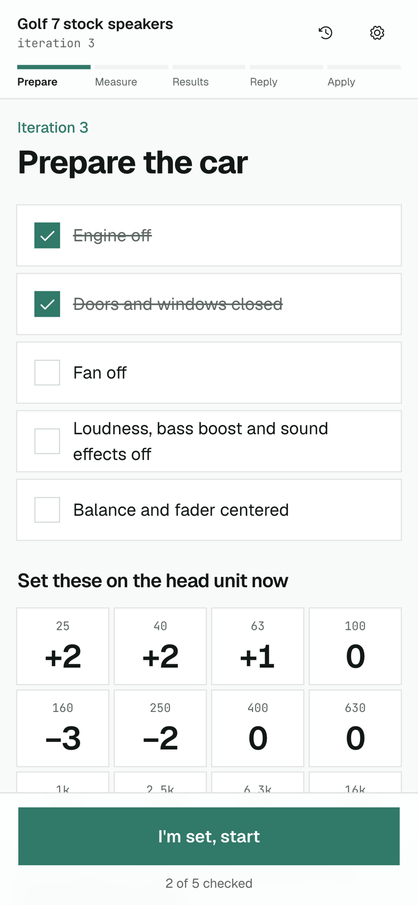
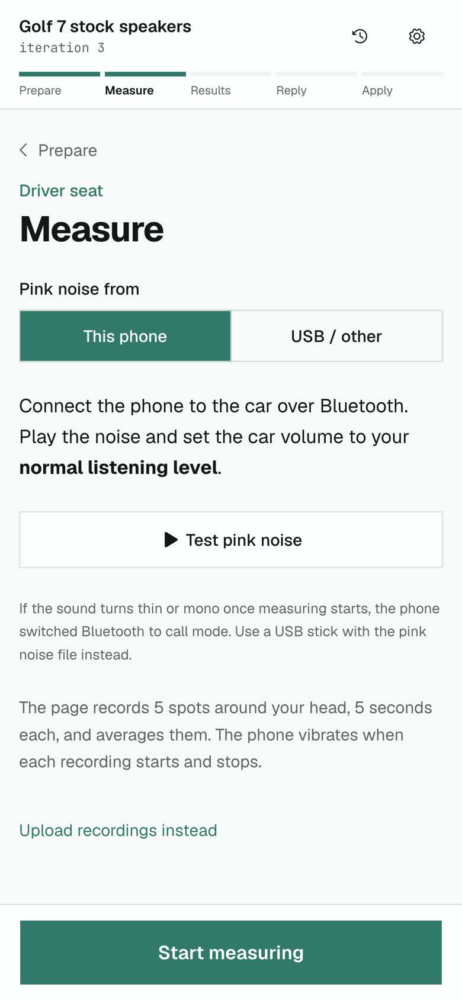
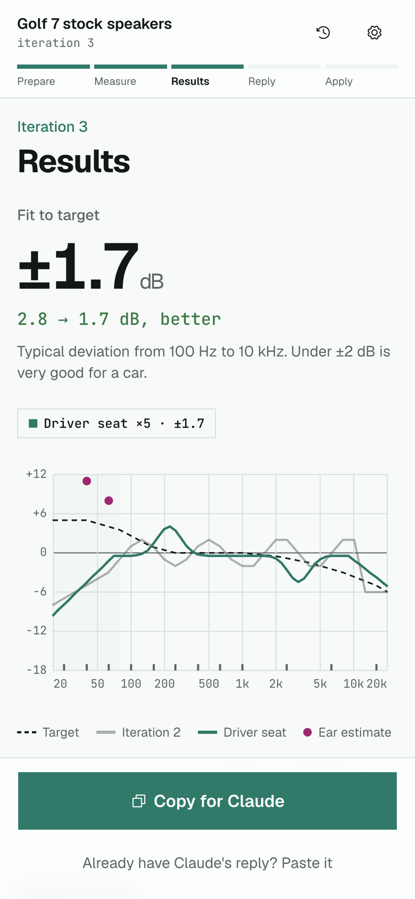
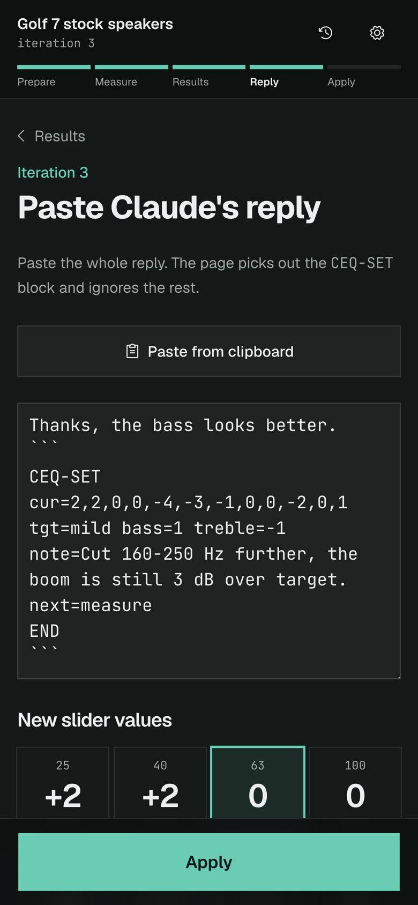
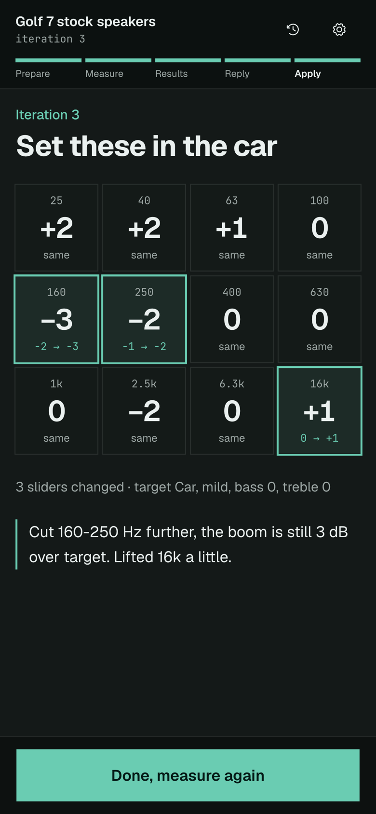
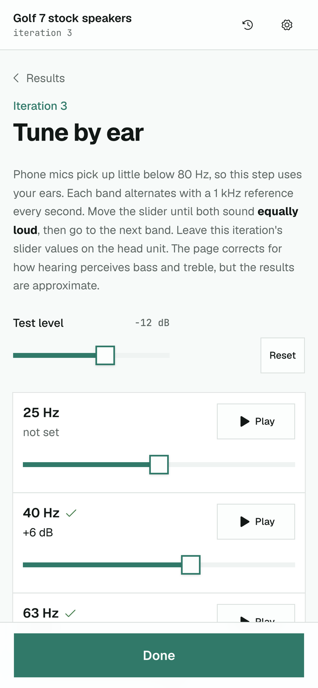

# Car EQ Bench

Car EQ Bench helps you tune the equalizer of a car head unit with your phone. It plays pink noise through the car, records it with the phone's microphone and compares the result with a target sound. Then it shows a value for every EQ slider. You can paste the measurement into a Claude chat for a second opinion and paste Claude's answer back into the page.

Open it on your phone: https://gulianrdgd.github.io/car-eq/

Everything runs in the browser. Measurements and settings stay in the phone's local storage, and the page sends nothing to a server.

<table>
  <tr>
    <td></td>
    <td></td>
    <td></td>
  </tr>
  <tr>
    <td>Prepare the car and set the current values</td>
    <td>Measure with the phone's mic</td>
    <td>See how close you are to the target</td>
  </tr>
  <tr>
    <td></td>
    <td></td>
    <td></td>
  </tr>
  <tr>
    <td>Paste Claude's reply</td>
    <td>Set the new values in the car</td>
    <td>Tune the bass by ear</td>
  </tr>
</table>

## How a tuning round works

The first time, Setup asks for the band frequencies from your EQ screen (`1k` and `2.5k` work), the maximum boost or cut per slider, the step size and a name for the car. After that you go round a loop until the car sounds right.

1. On the Prepare screen, tick off the checklist: engine off, doors and windows closed, fan off, loudness and bass boost off, balance centered. Then set the slider values the page shows. In the first round they are all 0.
2. On Measure, play the pink noise at your normal listening volume, from the phone over Bluetooth or from a USB stick. The page checks the level, then records five spots around your head for 5 seconds each and averages them. The phone vibrates when each recording starts and stops.
3. Results shows the fit, which is the typical deviation from the target between 100 Hz and 10 kHz. Under ±2 dB is very good for a car. The chart compares this round with the previous one. Tap "Copy for Claude" and paste the text into a Claude chat.
4. On the reply screen, paste Claude's whole answer. The page finds the settings block, shows which sliders change, and applies them when you confirm.
5. The Apply screen shows the new values in large type with the changes highlighted. Set them on the head unit and measure again.

You can also measure the passenger seat, tune the bass by ear, go back to the values of an earlier round from History, or apply the page's own suggestion without asking Claude.

## Tips for good measurements

- Some phones switch Bluetooth to call mode when the mic turns on. The noise then sounds thin or mono, and the recording may come from the car's own microphone. If that happens, pick "USB / other" on the Measure screen, download `pink-noise-60s.wav` and play it from a USB stick.
- Phone mics pick up little below 80 Hz, so the chart shows less bass than you hear. That range is shaded on the chart. Use "Tune the bass by ear" for it: each band alternates with a 1 kHz tone and you move a slider until both sound equally loud.
- The mic needs https and your permission. The GitHub Pages link above uses https.

## The text format for Claude

"Copy for Claude" produces a compact text block that starts with `CEQ1`. Its first line explains the format, so a new Claude chat can answer without any other context. The block holds the bands, the current slider values, the target and the measured response at 31 points.

Claude answers with a `CEQ-SET` block:

```
CEQ-SET
cur=2,2,0,0,-4,-3,-1,0,0,-2,0,1
tgt=mild bass=1 treble=-1
note=Cut 160-250 Hz further, the boom is still 3 dB over target.
next=measure
END
```

`cur` is required and has one value per band. The page clamps values to your slider range and rounds them to the step size, and it warns you when it had to clamp. `tgt`, `bass`, `treble` and `note` are optional. `next` says what comes after applying: `measure`, `passenger`, `ear:40,63` or `done`. The page ignores text around the block and accepts code fences, `+` signs and `key: value`. The full spec is in [docs/v3-plan.md](docs/v3-plan.md).

## Development

Built with SvelteKit as a static site, Svelte 5, shadcn-svelte and Tailwind CSS 4.

```sh
yarn install
yarn dev          # http://localhost:5173
yarn dev:phone    # https on your network, to test the mic on a phone
yarn test         # parser, exporter, round trip and analysis tests
yarn run check    # type check
yarn build        # static site in build/
```

`yarn dev:phone` uses a self-signed certificate, so the phone shows a warning once.

The measuring and tuning logic is in `src/lib/eq/`:

- `dsp.ts` has the FFT, the 1/6-octave analysis, the target curves and the slider suggestion.
- `ceq.ts` writes the `CEQ1` text and reads `CEQ-SET` replies.
- `session.svelte.ts` holds the state of the tuning loop and saves it to local storage.
- `audio.svelte.ts` plays the pink noise and the ear test, and records from the mic.

Each screen is a route in `src/routes/`.

## Deployment

Every push to `main` runs the type check and the tests on GitHub Actions, then builds the site and deploys it to GitHub Pages. The build reads its base path (`/car-eq`) from the Pages settings through the `BASE_PATH` variable.
